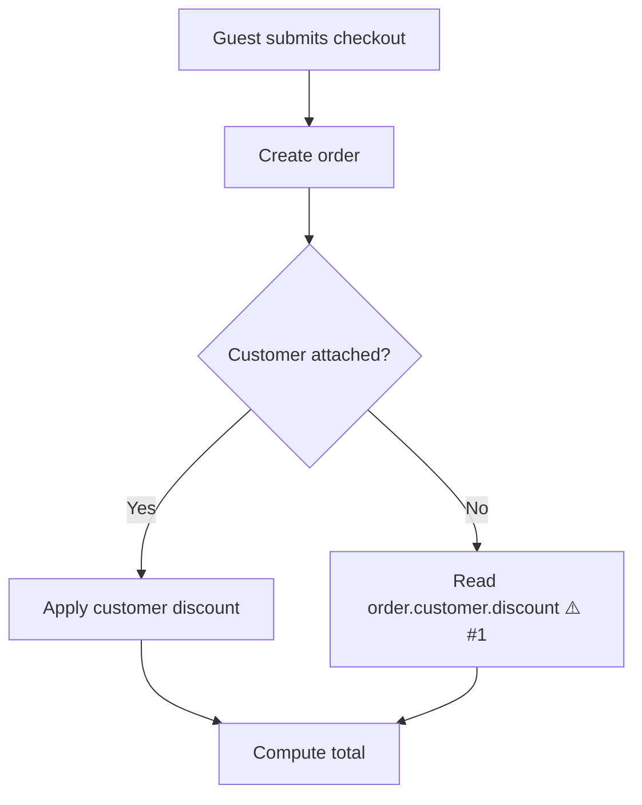

# AI PR review

One GitHub review per run: a summary body plus one comment per finding, pinned to the exact line. The author cannot approve their own PR, so the verdict is a `COMMENT` review and a label, never `APPROVE`; people approve.

## Inputs

From the pipeline: the PR number, `<criteriaDir>`, the class, the backend, the model and the effort. Standalone (`/pr-pipeline:review <n>`): read the repo profile the way the run skill does (`.pr-pipeline.json`, then `.claude/pr-pipeline.json`, else defaults), take the backend, model and effort from `{ action: "settings" }` (`reviewer`, `review_model`, `review_effort`), and treat the PR as the feature class unless the diff shows a sensitive signal (auth, permissions, money, PII, migrations, contracts, infra, secrets, dependency bumps).

## Gather

```bash
gh pr view <n> --json number,title,body,headRefName,baseRefName,url,files,author
gh pr diff <n>
BASE=$(git merge-base HEAD origin/<base>)
```

Read the acceptance criteria from `<criteriaDir>/acceptance.md`. When it is missing, find the ticket from the PR body's link line, fetch it through its tracker and extract the criteria now; with no ticket, use the PR body's stated intent and mark every criterion `(derived)`.

## The prompt file

Write `<criteriaDir>/review-prompt.md`, the one input every backend reads:

1. The rules and the JSON contract from the plugin's `agents/reviewer.md` (two directories up from this skill's directory), verbatim: everything after its front matter.
2. Branch, base SHA, PR title and body.
3. The acceptance criteria.
4. The changed file list.
5. The repo rule files to respect: the profile's `rules`.
6. For CLI backends (codex, opencode) only: the full diff (`git diff $BASE...HEAD`) in a `diff` block. A diff over 200 KB is cut to the file list with a note in the prompt that the reviewer must read the files itself.

## Backends

Every backend answers with the same JSON: the contract in `agents/reviewer.md` (`verdict`, `description_confidence`, `description_note`, `acceptance[]`, `findings[]`).

| Backend | How it runs | Models | Effort |
| --- | --- | --- | --- |
| claude | Agent tool, `subagent_type: "pr-pipeline:reviewer"`, `model` and `effort` from routing or settings, prompt = the prompt file's sections 2–5 (the agent already carries the rules) | `settings.claudeModels` | `low` … `max` |
| codex | `codex exec --model <m> --sandbox read-only -c model_reasoning_effort="<low\|medium\|high>" -o <criteriaDir>/review-codex.json - < <criteriaDir>/review-prompt.md`, run from the repo root | the codex config default, `gpt-5-codex`, `gpt-5`, `o3`, or free text | `xhigh` and `max` map to `high`; record a `note` when they do |
| opencode | `opencode run --model <provider/model> "$(cat <criteriaDir>/review-prompt.md)" > <criteriaDir>/review-opencode.txt`, run from the repo root | `opencode models` lists them | ignored; record a `note` |

opencode has no read-only sandbox. Run `git status --porcelain` before and after; on any difference, restore the tracked files it changed (`git restore <paths>`), `trash` the untracked files it created, and record a `flag: "opencode changed files during review; reverted"`.

### Choosing the backend

- `settings.reviewer` is `codex` or `opencode`: use it.
- Neither `settings.harnesses.codex` nor `settings.harnesses.opencode` is set: claude, silently.
- Otherwise the run skill's stage-1 question has already asked once and saved the answer through `{ action: "settings", set: { reviewer, review_model, review_effort } }`; standalone, use the settings as they are.

The model and effort come from the pipeline's routing for claude; for codex and opencode they come from `review_model` and `review_effort`.

### Parsing and fallback

Take the last balanced `{…}` in the output after stripping code fences, and parse it as JSON. A reply that does not parse or misses `verdict` is re-asked once with "Answer with the JSON object only." (claude: a follow-up to the same agent; codex and opencode: the same command again). Fall back to claude at the routed model and effort (standalone: `opus`, `low`) when the reply is still invalid, the binary is missing, the command exits non-zero, or the output is empty, and record `flag: "Review fell back to claude/<model>: <reason>"`. Keep `review-codex.json` or `review-opencode.txt` next to the prompt for the record.

### Security pass

For the sensitive class (and standalone when a sensitive signal is in the diff), add a second pass:

- backend claude and the profile names a `securityAgent`: spawn that agent with the prompt file's sections 2–5 plus "Report only security findings, as JSON in the `findings` shape of the contract above."
- otherwise: run the same backend again with `security-prompt.md` from this skill's directory appended to the prompt file (write it as `<criteriaDir>/review-prompt-security.md`).

Merge the security findings into the main ones by `path:line`: on a collision keep the higher severity and confidence and join the bodies. A high security finding sets the verdict to `changes_requested`.

## Verify

Check each finding yourself before posting: open the file at the line. Drop a finding whose line is not part of the diff or whose claim the code does not support. Keep the reviewer's confidence where you agree; lower it when you half agree.

## Post

Write `<criteriaDir>/review.json`:

```json
{
  "event": "COMMENT",
  "body": "<summary markdown>",
  "comments": [
    { "path": "src/orders/total.ts", "line": 42, "side": "RIGHT", "body": "<finding markdown>" }
  ]
}
```

```bash
gh api repos/{owner}/{repo}/pulls/<n>/reviews --input <criteriaDir>/review.json
```

### Finding comment

````markdown
 
**Null customer breaks the total**

`orderTotal()` reads `order.customer.discount`, but guest checkouts create the order before a customer is attached.

```suggestion
const discount = order.customer?.discount ?? 0;
```
````

Badge colours: confidence 80 and up `2ea44f`, 60 to 79 `dbab09`, under 60 `9f9f9f`; severity high `d73a4a`, medium `fbca04`, low `0075ca`. Include the suggestion block only when the reviewer gave replacement code that compiles in place.

### Summary body

````markdown
## AI review · LGTM 👍            (or: ## AI review · Changes requested)

🟢 Confidence: 92% · 🟢 Verdict: lgtm            (🟢 80+ · 🟡 60–79 · 🔴 under 60; verdict 🔴 when changes requested)

  

<one sentence on whether the PR body matches the diff>

| Acceptance criterion | Met | Evidence |
| --- | --- | --- |
| Total includes the discount | ✅ | `orderTotal.test.ts › applies discount` |
| Guest checkout shows no discount row | ⚠️ partial | branch exists, no test |

| # | File | Severity | Confidence | Finding |
| --- | --- | --- | --- | --- |
| 1 | `src/orders/total.ts:42` | high | 85% | Null customer breaks the total |

<details open><summary><b>How the change runs</b></summary>



</details>

Reviewed by <backend> <model> at <effort> effort. Line comments carry a confidence score each; replies on the thread are read by the pipeline's address stage.
````

The diagram is the reviewer's reading of what the changed code does at runtime, so a reader who skips the diff still learns the behaviour:

- Top-down (`flowchart TD`), 4–10 nodes, each a step in plain domain words (`Queue filing after commit`, not `FileJob.php`). Name a function only when the reader needs it to find the code.
- Show every decision the diff adds or changes as a `{question?}` node with labelled `Yes`/`No` edges, including skip, retry and failure paths.
- Mark the node a finding lands on with `⚠️ #n`, matching the findings table.
- Never draw the review, the pipeline, the diff or a list of files.
- Omit the block when the change has no flow of three or more steps: a copy change, a renamed field, a config value, a pure shape change. The footer names what actually ran, after any fallback.

## Label and record

Swap the labels from the profile map; a `null` key is skipped:

```bash
gh pr edit <n> --remove-label "<labels.aiChangesRequested>" --add-label "<labels.aiLgtm>"   # or the reverse
```

Record with `mcp__pr-pipeline__pipeline` on stage `review`: the `running` call carries `backend`, `model` and `effort`; the closing call has status `done`, summary `lgtm · 3 findings` or `changes requested · 1 high` (keep the literal phrase `changes requested`; the pane keys on it), confidence = `description_confidence`, one `did` per posted finding (`src/orders/total.ts:42 · high · null customer`), a `flag` per finding dropped as unverifiable and per fallback, and a `link` to the review URL the API returned (`html_url`). End with `{ action: "pr" }` so the pane's Threads card shows the new comments.
