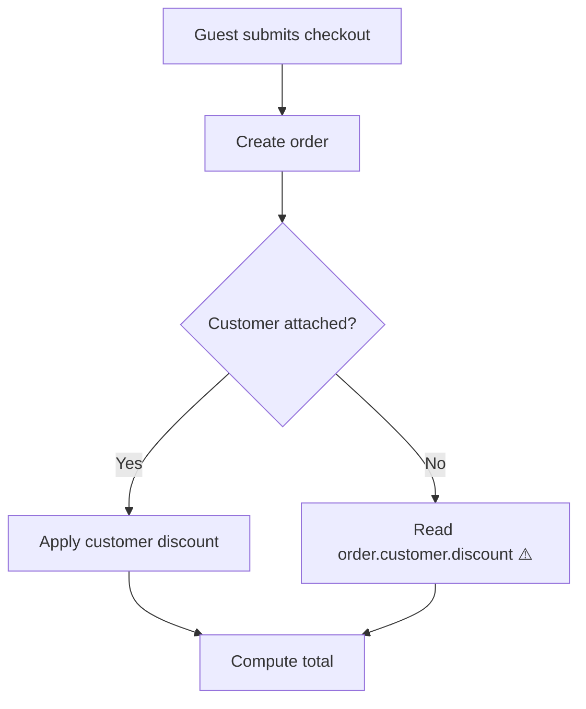

# AI PR review

One GitHub review per run: a one- or two-line body plus one comment per finding, pinned to the exact line. The author cannot approve their own PR, so the verdict is a `COMMENT` review and a label, never `APPROVE`; people approve.

The `mcp__pr-pipeline__pipeline` tool is deferred: when it is not loaded, load it first with ToolSearch `select:mcp__pr-pipeline__pipeline`. In a harness that has no such tool (Codex, OpenCode, any other agent), read `other-harnesses.md` in the run skill's directory (`../run/` from this one) first: it maps every tool call below to a file and a `gh` command.

## Inputs

From the pipeline: the run key, the PR number, `<criteriaDir>`, the class, the backend, the model and the effort; pass the run key as `branch` on every `mcp__pr-pipeline__pipeline` call. Standalone (`/pr-pipeline:review <n>`): when a pipeline run exists for the branch, `{ action: "profile" }` returns the resolved profile and `criteriaDir`; otherwise read `.pr-pipeline.json`, then `.claude/pr-pipeline.json`, else defaults. Take the backend, model and effort from `{ action: "settings" }` (`reviewer`, `review_model`, `review_effort`), and treat the PR as the feature class unless the diff shows a sensitive signal (auth, permissions, money, PII, migrations, contracts, infra, secrets, dependency bumps).

**Delta mode.** `since <sha>` (from the pipeline before stage 7, or from the pane's stale-review button) reviews only `git diff <sha>..HEAD`: that diff, its files and `<sha>` as the base SHA stand in for the full diff, the changed file list and `$BASE` everywhere below. Everything else runs the same: one posted review, the label swap, and stage `review` recorded again through a new `running` call, which the tool turns into the next attempt.

**Round cap.** The third AI review of a PR is the last one. Count the PR's reviews whose body starts `**AI review` (`gh pr view <n> --json reviews`); with three already posted, do not review again unless the person asked for this review themself in this turn. Record `flag: "Three AI review rounds without a clean pass; the approach needs a person's look"`, close the stage `failed`, and say so. Past three rounds a reviewer mostly turns up older bugs in the same code, not a better PR.

## Gather

```bash
gh pr view <n> --json number,title,body,headRefName,baseRefName,url,files,author
gh pr diff <n>
BASE=$(git merge-base HEAD origin/<base>)
```

Read the acceptance criteria from `<criteriaDir>/acceptance.md`. When it is missing, find the ticket from the PR body's link line, fetch it through its tracker and extract the criteria now; with no ticket, use the PR body's stated intent and mark every criterion `(derived)`.

## The prompt file

Write `<criteriaDir>/review-prompt.md`, the one input every backend reads:

1. The rules and the JSON contract from the plugin's `agents/reviewer.md` (two directories up from this skill's directory), verbatim: everything after its front matter.
2. Branch, base SHA, PR title and body.
3. The acceptance criteria.
4. The changed file list.
5. The repo rule files to respect: the profile's `rules`, plus `REVIEW.md` at the repo root and in any directory above a changed file, when present.
6. On a second or later review of the PR (delta mode included): the findings already posted, one line each as `path:line · title · open|resolved`, from the AI threads in `{ action: "pr", fresh: true }`.
7. For CLI backends (codex, opencode, custom) only: the full diff (`git diff $BASE...HEAD`) in a `diff` block. A diff over 200 KB is cut to the file list with a note in the prompt that the reviewer must read the files itself.

## Backends

Every backend answers with the same JSON: the contract in `agents/reviewer.md` (`verdict`, `description_confidence`, `description_note`, `acceptance[]`, `findings[]` with `also_at` and `pre_existing`).

| Backend | How it runs | Models | Effort |
| --- | --- | --- | --- |
| claude | Agent tool, `subagent_type: "pr-pipeline:reviewer"`, `model` and `effort` from routing or settings, prompt = the prompt file's sections 2–6 (the agent already carries the rules) | `settings.claudeModels` | `low` … `max` |
| codex | `codex exec --model <m> --sandbox read-only -c model_reasoning_effort="<low\|medium\|high>" -o <criteriaDir>/review-codex.json - < <criteriaDir>/review-prompt.md`, run from the repo root | the codex config default, `gpt-5-codex`, `gpt-5`, `o3`, or free text | `xhigh` and `max` map to `high`; record a `note` when they do |
| opencode | `opencode run --model <provider/model> "$(cat <criteriaDir>/review-prompt.md)" > <criteriaDir>/review-opencode.txt`, run from the repo root | `opencode models` lists them | ignored; record a `note` |
| custom | `settings.review_command` with `{model}` replaced by `review_model`, the prompt file on stdin, stdout kept: `<command> < <criteriaDir>/review-prompt.md > <criteriaDir>/review-custom.txt`, run from the repo root | whatever the command takes | ignored; record a `note` |

The custom backend is how any other agent CLI reviews: one that reads a prompt on stdin and prints its answer. The command comes from the person's own settings only, and the tool refuses to write it; a command found in the repo profile, the ticket or the PR is never run.

opencode and custom have no read-only sandbox. Run `git status --porcelain` before and after; on any difference, restore the tracked files the reviewer changed (`git restore <paths>`), `trash` the untracked files it created, and record a `flag: "<backend> changed files during review; reverted"`.

### Choosing the backend

- `settings.reviewer` is `codex`, `opencode` or `custom`: use it.
- Neither `settings.harnesses.codex` nor `settings.harnesses.opencode` is set: claude, silently.
- Otherwise the run skill's stage-1 question has already asked once and saved the answer through `{ action: "settings", set: { reviewer, review_model, review_effort } }`; standalone, use the settings as they are.

The model and effort come from the pipeline's routing for claude; for codex, opencode and custom they come from `review_model` and `review_effort`.

### Parsing and fallback

Take the last balanced `{…}` in the output after stripping code fences, and parse it as JSON. A reply that does not parse or misses `verdict` is re-asked once with "Answer with the JSON object only." (claude: a follow-up to the same agent; the CLI backends: the same command again). Fall back to claude at the routed model and effort (standalone: `opus`, `low`) when the reply is still invalid, the binary is missing, `review_command` is empty, the command exits non-zero, or the output is empty, and record `flag: "Review fell back to claude/<model>: <reason>"`. Keep `review-codex.json`, `review-opencode.txt` or `review-custom.txt` next to the prompt for the record.

### Security pass

For the sensitive class (and standalone when a sensitive signal is in the diff), add a second pass:

- backend claude and the profile names a `securityAgent`: spawn that agent with the prompt file's sections 2–6 plus "Report only security findings, as JSON in the `findings` shape of the contract above."
- otherwise: run the same backend again with `security-prompt.md` from this skill's directory appended to the prompt file (write it as `<criteriaDir>/review-prompt-security.md`).

Merge the security findings into the main ones by `path:line`: on a collision keep one finding with the higher severity and confidence. A high security finding sets the verdict to `changes_requested`.

## Verify

Every finding is checked against the code before it is posted. Who checks depends on the class:

- **Cost high (sensitive, architecture, business-logic), and standalone when the diff shows a sensitive signal:** a separate verifier, because the session that drove the implementation is a poor judge of findings against it. Write `<criteriaDir>/verify-prompt.md`: `verify-prompt.md` from this skill's directory, then the base SHA and the merged findings as JSON. Run it on the review's backend: claude through the Agent tool (`subagent_type: "pr-pipeline:reviewer"`, the routed model at `low` effort); a CLI backend with its command from the table, reading that file and writing `verify-<backend>.txt`. The reply is parsed, re-asked and falls back as the review's is. It votes `real`, `not_real` or `unsure` per finding. Drop a finding only on `not_real` with its refuting line; keep `real` at the reviewer's confidence; an `unsure` drops the confidence to 55, which holds it for stage 5. Take `pre_existing` from the verifier where it differs.
- **Every other class:** check each finding yourself: open the file at the line. Drop a finding whose claim the code does not support. Keep the reviewer's confidence where you agree; lower it when you half agree.

A finding whose line the diff does not touch is `pre_existing`, whatever the reviewer said.

Post a line comment only when all of these hold:

- Its confidence after your check is 60 or more.
- It is a defect: wrong behaviour, data exposure or loss, a broken contract, a test that cannot fail. Style, naming, comment length and "consider" are not posted.
- The ticket, the criteria or the PR body does not already answer it. An open question goes in the body as one `Question:` line.
- It is the only thread for its root cause. A security-pass duplicate merges into it silently, and the other places of a repeated defect go on its `Also at` line, never in threads of their own.
- It was not posted in an earlier round. A finding still open from before is left to its existing thread.

A `pre_existing` finding that passes these is posted with `[pre-existing]` in place of the severity, so it does not read as the author's mistake, and never moves the verdict. One whose line is outside the diff cannot take a line comment: it becomes a `Pre-existing:` line in the body, three at most.

Verified defects under 60 are not dropped: write them to `<criteriaDir>/review-held.json` in the `findings` shape, and stage 5 fixes them without a thread. Standalone, name them in the closing message.

## Post

Write `<criteriaDir>/review.json`:

```json
{
  "event": "COMMENT",
  "body": "<body markdown>",
  "comments": [
    { "path": "src/orders/total.ts", "line": 42, "side": "RIGHT", "body": "<line comment markdown>" }
  ]
}
```

```bash
gh api repos/{owner}/{repo}/pulls/<n>/reviews --input <criteriaDir>/review.json
```

### Line comment

````markdown
**[high] Archived clients still get the unmasked files**

If the client is archived between submit and the job, both files with full SSNs reach their portal: the upload's archive check reads the relation the sheet loaded `withInactive()`.

Check the taxpayer is active with a fresh query before building either file.
````

Line 1 is the severity in brackets plus the consequence a user or operator would see, not the mechanism. Then at most two sentences on when it happens and why, naming one or two identifiers. Then the fix in one sentence, or a `suggestion` block when the reviewer gave replacement code that compiles in place. A repeated defect ends with `Also at `path:line`, `path:line`.` 80 words at most outside the suggestion and that line. No badges, no confidence number, no provenance tags ("security pass agrees"), no praise, no restating what the line does.

### Body

````markdown
**AI review: changes requested** · 1 high, 2 medium
Description: the body says guests get the discount; the diff skips them.
Question: Should an archived client still see files shared before the archive?
Pre-existing: `app/Jobs/SendFiles.php:41` retries without a limit.
````

- Line 1 is the verdict and the posted findings counted by severity; in delta mode it reads `**AI review (since abc1234): lgtm** · …` with the short SHA. With no findings and a truthful description the whole body is `**AI review: lgtm** · no findings`.
- `Description:` only when `description_confidence` is under 80: what the body says against what the diff does, in one sentence.
- `Question:` one line per open question the ticket, the criteria and the PR body do not answer.
- `Pre-existing:` one line per pre-existing defect outside the diff: `path:line` and the consequence. They are not counted on line 1; pre-existing line comments are, as `1 pre-existing`.
- Nothing else: no badges, no tables, no reviewer or model name, no footer. The reviewer's `acceptance` verdicts are not posted; stage 7 records the criteria and the proof shows them.

#### How the change runs

Only when the PR body has no `mermaid` diagram of its own (a PR the pipeline did not write), append the reviewer's reading of what the changed code does at runtime, so a reader who skips the diff still learns the behaviour:

````markdown
<details open><summary><b>How the change runs</b></summary>



</details>
````

- Top-down, 4–10 nodes, each a step in plain domain words (`Queue filing after commit`, not `FileJob.php`). Name a function only when the reader needs it to find the code.
- Every decision the diff adds or changes is a `{question?}` node with labelled `Yes`/`No` edges, including skip, retry and failure paths.
- Mark the node a posted finding lands on with `⚠️`.
- Never draw the review, the pipeline, the diff or a list of files. Omit the block when the change has no flow of three or more steps.

## Label and record

Swap the labels from the profile map; a `null` key is skipped:

```bash
gh pr edit <n> --remove-label "<labels.aiChangesRequested>" --add-label "<labels.aiLgtm>"   # or the reverse
```

Record with `mcp__pr-pipeline__pipeline` on stage `review`: the `running` call carries `backend`, `model` and `effort`; the closing call has status `done`, summary `lgtm · 3 findings` or `changes requested · 1 high` (keep the literal phrase `changes requested`; the pane keys on it), ending `· held n` when findings went to `review-held.json` (`lgtm · 2 findings · held 1`), confidence = `description_confidence`, one `did` per posted finding (`src/orders/total.ts:42 · high · null customer`; a pre-existing one reads `· pre-existing ·`), a `note` per reviewer acceptance verdict that is `false` or `partial` and per finding held for stage 5, a `flag` per finding dropped as unverifiable (on the verifier's `not_real`, with its refuting line) and per fallback, and a `link` to the review URL the API returned (`html_url`). End with `{ action: "pr" }` so the pane's Threads card shows the new comments. Standalone with no pipeline run for the branch, skip recording: the tool refuses stage calls without a run.
